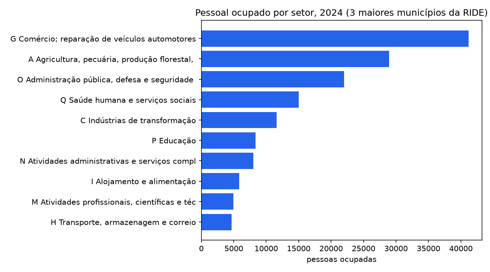
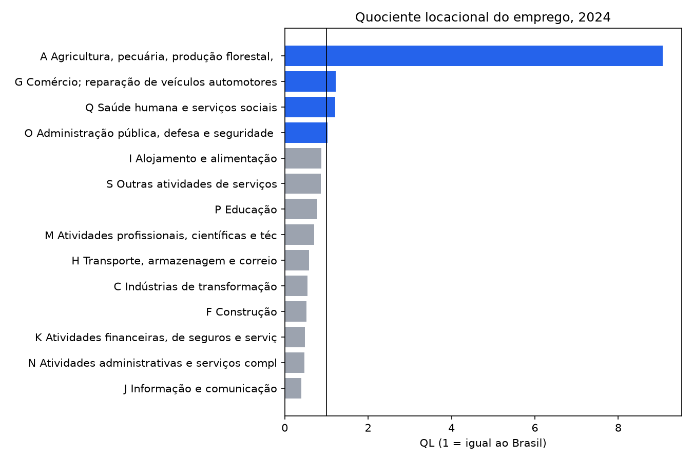
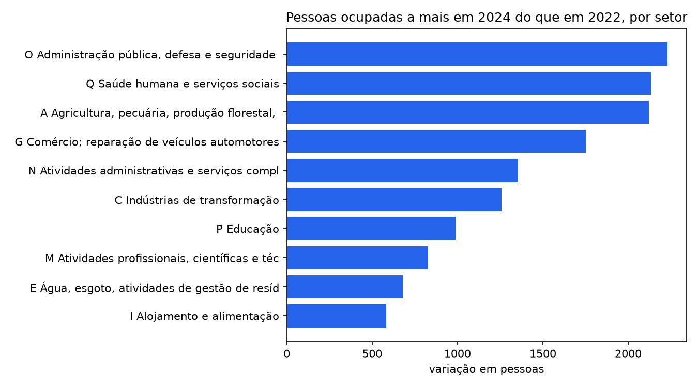
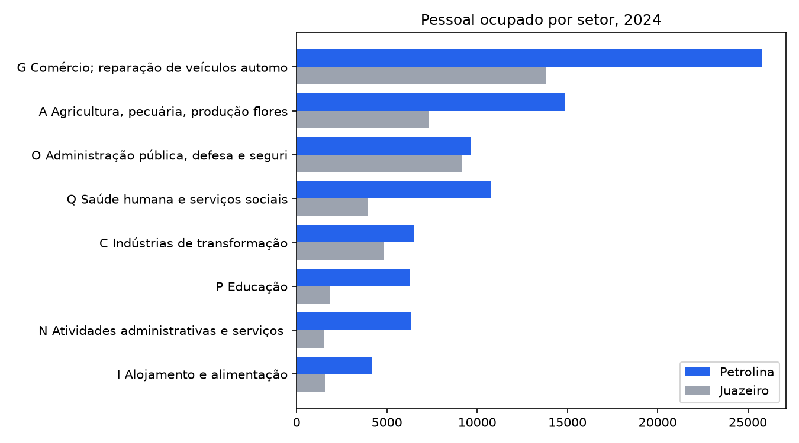

# Onde estão as empresas e os empregos no Polo Petrolina–Juazeiro

**Problema de negócio:** uma assessoria empresarial do Vale do São Francisco quer decidir onde prospectar. Quais setores concentram mais estabelecimentos e empregos formais na região, em quais a região é mais especializada que o Brasil e o que cresceu entre 2022 e 2024?

**Dados:** Cadastro Central de Empresas do IBGE (SIDRA, tabelas [9509](https://sidra.ibge.gov.br/tabela/9509) e [9510](https://sidra.ibge.gov.br/tabela/9510)), 2022 a 2024, para os 8 municípios da RIDE Petrolina–Juazeiro e para o Brasil.

**Ferramentas:** Python, SQL (DuckDB), pandas e matplotlib. A análise completa está em [`analise.ipynb`](analise.ipynb).

## O que os dados mostram

**1. Três municípios concentram 91% do emprego formal da região.** Petrolina, Juazeiro e Casa Nova somam 167 mil das 184 mil pessoas ocupadas da RIDE em 2024. Como o IBGE só abre os dados por setor para municípios com 50 mil habitantes ou mais, o resto da análise usa esses três, que representam quase toda a região.

**2. Comércio é o maior empregador; agricultura é a grande especialização.** O comércio emprega 41 mil pessoas (25% do total) em quase 9.800 estabelecimentos. A agricultura emprega 29 mil, ou 17% do emprego formal da região, contra 1,9% no Brasil: um quociente locacional de 9,1. Ela faz isso com só 724 estabelecimentos, ou seja, poucos empregadores grandes.





**3. O emprego formal cresceu 11% em dois anos**, de 151 mil para 167 mil pessoas, e os estabelecimentos passaram de 22 mil para 25,5 mil (+16%). Os maiores ganhos vieram de administração pública, saúde, agricultura e comércio.



**4. Saúde e serviços profissionais são os setores que mais abriram estabelecimentos.**

| Setor | Estabelecimentos 2024 | Variação de estabelecimentos | Variação do emprego | Quociente locacional |
|---|---|---|---|---|
| Comércio | 9.779 | +10% | +4% | 1,22 |
| Saúde humana e serviços sociais | 2.079 | **+35%** | +17% | 1,21 |
| Atividades profissionais, científicas e técnicas | 1.671 | **+28%** | +20% | 0,71 |
| Atividades administrativas e serviços complementares | 1.596 | +18% | +20% | 0,47 |
| Construção | 1.382 | +19% | +4% | 0,53 |
| Alojamento e alimentação | 1.178 | +19% | +11% | 0,88 |
| Indústrias de transformação | 1.155 | +13% | +12% | 0,54 |

**5. Petrolina puxa a região.** Emprega quase o dobro de Juazeiro no comércio e de 2,7 a 4 vezes mais em saúde, educação e serviços administrativos. Em administração pública, as duas cidades estão próximas (9,7 mil e 9,2 mil pessoas).



## Recomendação para a assessoria

1. **Saúde:** é especialização da região (QL 1,21) e o setor que mais abriu estabelecimentos (+35%). Clínicas novas precisam de gestão, processos e marketing desde o começo.
2. **Serviços profissionais** (contabilidade, advocacia, engenharia, consultoria): +28% de estabelecimentos, mas ainda abaixo da média nacional (QL 0,71). É um mercado que cresce e ainda tem espaço.
3. **Comércio:** a maior base de possíveis clientes (quase 9.800 estabelecimentos), mas o emprego cresce pouco (+4%). Bom para produtos de escala, como automação de atendimento.
4. **Agricultura:** poucos estabelecimentos (724), com muito emprego cada. Vale abordagem individual, conta a conta.

## Limitações

- O IBGE só publica a abertura por setor para municípios com 50 mil habitantes ou mais. Os outros 5 municípios da RIDE entram apenas nos totais.
- O cadastro cobre CNPJs (inclui órgãos públicos e entidades sem fins lucrativos) e não inclui trabalho informal, que pesa na agricultura.
- "Unidades locais" contam estabelecimentos, não empresas: uma rede com três lojas vale três.
- Quociente locacional mostra concentração relativa, não causa.

## Como reproduzir

```bash
pip install -r requirements.txt
python baixar.py                 # baixa os dados do IBGE para dados/
jupyter notebook analise.ipynb   # ou: python montar_notebook.py .   (gera e executa o notebook)
```

Os CSVs baixados em 17/11/2026 estão em [`dados/`](dados).

## Autor

Gean Bonni, desenvolvedor Python e pós-graduando em Ciência de Dados. [LinkedIn](https://www.linkedin.com/in/geanbonni) · [GitHub](https://github.com/geanprofcd)

Dados: IBGE, Cadastro Central de Empresas. Código sob licença MIT.
